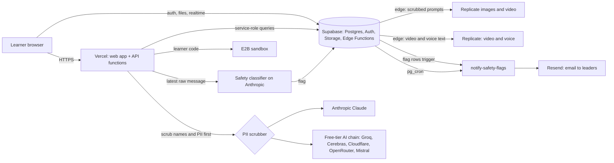

# nextVillage data map, retention and deletion

Status: first complete draft, 12 October 2026. Companion to `docs/Data-Protection-Summary.html`
(the Kenya Data Protection Act reading, rev. 3). This file is the working inventory: what we hold,
who else sees it, how long we keep it, and how a person's data is erased. Counts are approximate
and were read from the live database on 2026-10-12 (aggregates only, no personal data).

## 1. What we hold

| Group | Where (tables / buckets) | Personal data in it | Whose | Notes |
|---|---|---|---|---|
| Account & identity | `auth.users`, `profiles` (~325 rows) | name, email, username, school name, city, avatar, role, organization, approval status | learners, teachers, leaders | `profiles.age` was empty for 324 of 325 people. From 2026-10-14 everyone is asked once for their birth year (`profiles.birth_year`, year only, self-reported) so we can tell who is under 13 or under 18 (see section 6). |
| Learning work & AI conversations | `dashboard` (~5,600 rows, 62 MB), `ai_playground_chats`, `systems_think_*`, `tech_skills_progress`, `daily_reflections`, `anchor_attempts`, `learner_ai_memory`, `user_personality_baseline`, `evaluations` | free-text answers, full chat histories, AI evaluations, personality/assessment scores | learners | The largest and most sensitive store: children's own words. |
| Things students make | `student_games`, `student_sites`, `student_site_pages`, `image/video/voice_generations`, `video_studio_projects`; buckets `ai-images`, `ai-videos`, `ai-voices`, `site-assets`, `web-projects`, `video-frames` (~1.9 GB) | prompts, HTML, images, audio, video that may show or name real people | learners | Generated media is stored in private buckets and served by long-lived signed links. |
| Learner-to-learner chat | `together_rooms`, `together_messages` (~1,500 messages), bucket `together-assets` | messages, sender names, shared images | learners | Messages are scanned into `together_safety_flags`; leaders can report. |
| Certificates | bucket `certificates` (125 PDFs), `dashboard.certificate_pdf_url` | learner's full name on a PDF | learners | Bucket is public by design (learners share links). Files are named `<user-id>/<certificate>.pdf`. |
| Community-service records | `health_patients`, `health_assessments`, `agriculture_*`, `animal_husbandry_*`, `fishing_*`, `entrepreneurship_*`, `*_consultations`, `community_impact_journal`, `grand_challenge_submissions` | name, village, phone number, age, health triage summaries, business details, photos | **non-users**: patients, farmers, fishers, entrepreneurs entered by learners | Highest-risk data we hold about people who never signed up. About 43 patient and ~170 client records. |
| Safeguarding | `together_safety_flags`, `system_events` rows named `safety_flag_*` | the flagged message or prompt, student name and email, city | learners | Held for leaders to act on; emailed to leaders. |
| Operations | `system_events` (~64k rows), `api_cost_log` (~83k), `code_execution_log`, `daily_activity_log` | user id, page, cohort, city (cost log), errors | learners (indirectly) | Page views are logged per user. |
| Research & reporting | `dashboard_stats`, `user_monthly_assessments`, `assessments_monthly_global` | pseudonymous learner token, counts, scores | learners | Aggregates are reported by cohort. |
| Organization & staff contacts | `organizations`, `research_board_members` | mentor names, board member names and emails | adults | |
| Archive | `dashboard_placeholder_archive` (~32k rows, 9 MB) | placeholder rows removed from the dashboard in an earlier cleanup | none real | Candidate for deletion. |

## 2. Who else sees it

Everything below receives data because a request passed through it. "Scrubbed" means the text went
through `api/_lib/piiScrubbing.js` first (regex pass for emails, phones, addresses; an AI pass that
replaces names and places). Items marked *verify* are read from code and not confirmed with the vendor.

| Recipient | What it receives | Purpose | Location |
|---|---|---|---|
| **Supabase** | everything in section 1; login credentials | database, auth, file storage, edge functions | US (AWS), exact region *verify* |
| **Vercel** | all web and API traffic; request logs | hosting, API functions, cron | US functions, region not pinned |
| **Anthropic** | scrubbed chat and tutoring text; learner work for evaluation; the **unscrubbed** latest message for the safety classifier (by design, so leaders see the real words) | AI tutoring, evaluation, safety | US |
| **OpenAI** | learner prompts and code for task instructions and web-session evaluation (`gpt-4o`); optional Pidgin translation (`gpt-3.5`) | AI | US |
| **Free-tier AI chain**: Groq, Cerebras, Cloudflare Workers AI, OpenRouter, Mistral (code also references Gemini and DeepSeek) | scrubbed chat text for pages on the free tier | AI tutoring at no cost | various, terms not vetted |
| **E2B** | the code a student runs | sandboxed code execution | US *verify* |
| **Replicate** | image prompts (scrubbed), video prompts and voice text from the edge functions | image, video and voice generation | US |
| **ElevenLabs / SpeechGen** | text to be spoken (Pidgin text-to-speech) | voice | *verify* |
| **Resend** | leader email addresses; safety alerts containing student name, email, city and the flagged text; digests | email | US |
| **StackBlitz** | the student's own project code when they open a preview | live preview | US |
| Bluesky / X / LinkedIn digests | platform news only; no learner data intended | public posts | n/a |

## 3. Data flow



Boundary in one sentence: names and contact details are removed before text reaches an AI
vendor, except the safety classifier, which sees the raw latest message on purpose; everything
else a learner creates lives in Supabase, and a signed-in leader or administrator can see their
organization's data through the app.

## 4. Retention

### In force once the migration `20261012120100_user_erasure_and_log_retention` is applied

A nightly job (`purge-operational-logs`, 03:30 UTC) enforces these. Nothing about learner content
changes.

| Data | Rule |
|---|---|
| `system_events`, routine rows (page views, errors, model warnings) | deleted after 180 days |
| `system_events`, safeguarding rows (`safety_flag_*`) | deleted after 2 years |
| `api_cost_log` | rows kept for finance; after 13 months the link to a person (`user_id`, `city`) is cleared |
| `code_execution_log` | deleted after 30 days |

### Decided 14 October 2026 (Kevin), NOT yet enforced

These replace the earlier proposals. Nothing below is deleted automatically until the enforcement
migration is reviewed (row counts shown first) and Kevin says go.

| Data | Rule | Under-13 learners |
|---|---|---|
| AI chat and tutoring transcripts (`dashboard.chat_history`, `image_chat_history`, `video_chat_history`; `ai_playground_chats`; `systems_think_sessions.messages`) | 90 days, then the transcript is cleared. Scores, evaluations and evidence on the same row stay (they are the longitudinal record). | 60 days |
| Learner-to-learner messages (`together_messages`) | 12 months | peer chat off for under-13s |
| Generated images, audio, video, video frames and Together attachments (storage files) | 12 months (no pin option exists). **Live 2026-10-15:** nightly job `purge-learner-media` (04:00 UTC) deletes the files and clears the links to them | 6 months, only where a birth year under 13 is recorded (a blank birth year does not shorten it, because file deletion cannot be undone) |
| Assessment results (scores, evaluations) | kept at least 3 years from the start. Funders do not need individual-level results, so individual rows are de-identified (pseudonymous token, no name/email) once the learner leaves or after the retention window; reported only in groups. | same |
| Accounts with no activity for 12 months | leader review, then delete 90 days later. **Live 2026-10-15:** nightly flagging (`flag-inactive-accounts`, 04:15 UTC), an Inactive accounts card for leaders, and `npm run accounts:purge-due` for the administrator (dry run by default). Nothing is removed without a leader's decision; anyone who returns is taken off the list. "Activity" counts sign-ins, session refreshes and dashboard changes | same |
| Withdrawn accounts and accepted deletion requests | delete within 30 days. **Live 2026-10-15:** learners (or a parent or guardian) send a request from their profile; leaders and administrators see it, can lock the account at once, and an administrator erases it with `npm run user:delete` | same |
| Community-service records about non-users (patients, farmers, clients) | identifiers (name, village, phone) removed or the record deleted once the consultation is finished. Exact scope for a finished consultation to be confirmed. | forms off for under-13s |
| Certificates | kept while the account exists | same |
| `dashboard_placeholder_archive` | delete 90 days after sign-off | n/a |

Basis for the 90-day figure: leaders do not read old transcripts (no bandwidth), and the monthly
assessment only needs the current cycle. Row counts at decision time: 2,790 of 3,597 dashboard chat
histories and 74 of 184 playground chats are older than 90 days; no media, Together message or
systems-think session is old enough for its rule yet.

### Under-13 tier (decided, to be built)

Kevin decided NOT to exclude 8 to 12 year olds (Oloibiri children get five years of state-funded school;
without nextVillage they can be left without a route). They get a stricter tier switched on by
`profiles.birth_year`: leader-confirmed guardian permission, no peer chat, no names on leaderboards,
no public certificate links, AI limited to vetted vendors with scrubbing, stricter image/voice/video
filters, no forms about other people, shorter retention (above), and unthrottled safety alerts.

Built 14 October 2026 (PRs 255 to 258 plus the guardian-consent migration `20261014230000`): names and
photos hidden from other students; no peer chat (per-organization opt-in `allow_young_peer_chat`, on for
Back to Basics); Anthropic-only AI; no patient/farmer/client records. **Guardian consent (new learners
only):** when a leader approves a young learner's join request, the approval requires confirming that a
parent or guardian agreed, and the confirmation is stored in `guardian_consents` (learner, organization,
who confirmed, when, how: signed form / in person / other, short note). No guardian name or contact is
stored; the signed form stays with the program. Learners approved before this date are not asked for a
record. Leaders can read their organization's records; nobody can write them except through
`review_membership()`. Deleting a learner deletes their consent record.

## 5. Deletion of one person's data

Today a request is handled by an administrator running one command from the repository:

```
npm run user:delete -- person@example.com            # shows what would be removed (changes nothing)
npm run user:delete -- person@example.com --confirm  # does it
```

What happens (`scripts/delete-user.ts`):

1. Every file stored under `<user-id>/` in every storage bucket is removed. Database cascades do not
   touch stored files, so this runs first.
2. The Supabase Auth user is deleted. About 40 tables point at it with cascading foreign keys, so the
   person's rows go with it. Nine references that used to block a delete (champions, referrals, and
   reviewer/creator columns) are fixed by the same migration: personal rows cascade, reviewer ids are
   simply cleared.
3. Leaders, teachers and administrators are refused unless `--allow-staff` is passed.

Cannot be removed by this process, and should be said up front to anyone asking:

- their name inside another learner's free text, shared chat rooms, or a leader's notes;
- safety flags and alert emails already sent (a safeguarding record is not erased on request);
- anonymized, aggregated research figures;
- anything a vendor holds under its own retention (Anthropic's API retention, Vercel logs, Resend logs).

Target turnaround to publish: 30 days. Still missing: a public way to ask (an email address or an in-app
request) and a guardian channel for minors.

## 6. Findings from this review

Fixed in this change set or the one before it:

- **Name scrubbing and the safety classifier were failing since 9 October.** The Haiku 5.5 move sent
  `temperature: 0`, which that model rejects with a 400. The name-extraction pass failed on every call
  (1,472 logged errors on 10 October) and the self-harm / harm classifier failed silently open.
  Fixed in PR 245 with tests; the classifier now logs a `safety_classifier_upstream_error` event when it
  cannot reach the model. The `generate-image` edge function carries the same fix in the repository but
  must be redeployed to take effect.
- **Anyone on the internet could list every file in three public buckets** (`certificates`,
  `video-frames`, `web-dev-images`), including every learner's user id. Existing links keep working;
  listing is removed by `20261012120000_storage_no_public_listing`.
- **Deleting a user was blocked** by nine foreign keys and left their files behind. Fixed by the
  migration and script above.
- **No retention existed for operational logs.** Fixed above.

Open, in priority order:

1. **Age is unknown for almost everyone** (`profiles.age` empty for 324 of 325). Under-13 and under-18
   detection, guardian consent and age-appropriate defaults all depend on collecting age or date of birth
   at sign-up. This is the first step of the compliance work (item 8).
2. **Records about non-users.** Patients, farmers and fishers are entered by learners with name, village and
   phone, and health triage summaries sit in `health_assessments`. These people have no account, no
   notice and no way to ask for deletion. They need a consent or notice practice at the point of entry and
   their own retention rule (section 4).
3. **Vendor terms for the free-tier AI chain and OpenAI** are not vetted (open item 02 of the summary).
4. **Alert email fallback** (`SAFETY_ALERT_FALLBACK_EMAIL`, open item 04 of the summary) is still unconfirmed.
5. **Hygiene (done 2026-10-15):** the redundant `VITE_OPENAI_API_KEY` variable was removed from Vercel and the code now
   reads only `OPENAI_API_KEY` (server side). Anything named `VITE_*` is shipped to browsers, so keep secrets off that prefix.
6. Confirm the exact Supabase and E2B regions in their dashboards.
